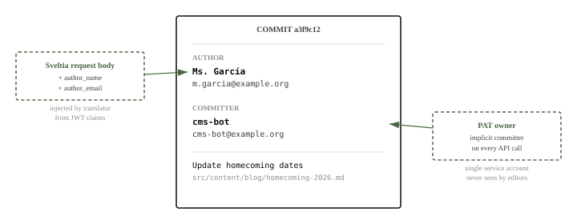
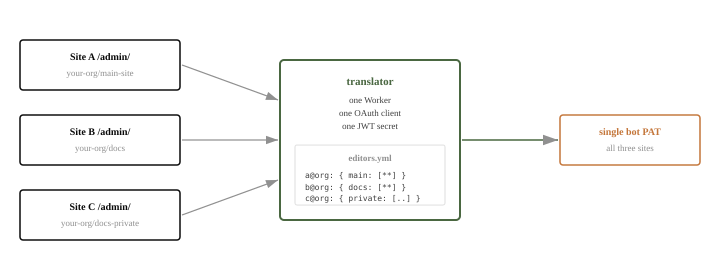

# Architecture

The decisions that aren't derivable from "it's a proxy", with the
reasoning behind each.

## Why GraphQL is parsed, not forwarded

GitLab's GraphQL `commitCreate` mutation has no author-override field;
a commit made through it attributes to the authenticated user, which
here is the service account. Translated identity needs the author
injected, and only REST `POST /repository/commits` accepts
`author_name` and `author_email`. Sveltia already reads through
GraphQL and writes through REST, so the proxy only has to keep it that
way.

A keyword filter on the body is not enough: a mutation can be spelled
around it, and a read query can name any project the service token can
see. So `/gitlab/graphql` parses the document and accepts one shape:
a single anonymous `query` whose only root is `project(fullPath:
$var)`, with the fields and arguments Sveltia's GitLab backend uses
and nothing else (no fragments, aliases, directives or literal
strings). The `fullPath` variable must name a repo the editor has an
entry for. The forwarded body is the printed AST with the declared
variables, so GitLab parses exactly what was checked. Everything else
is a 403 with no upstream call. A Sveltia release that reads a new
field is a new entry in the `PROJECT` tree in `src/graphql.ts`.

## Why `hd` is checked twice

Once on the authorize URL (Google's `hd` parameter), once on the
`id_token` (the `hd` claim, alongside `email_verified`). They are not
the same check.

The URL parameter is a hint. It filters Google's account chooser to
the named domain; a person with both a personal account and a
Workspace account can still pick the personal one. The claim is
signed by Google and is the boundary: an account from another domain,
or a personal account with no `hd` at all, fails it. An empty
`ALLOWED_DOMAIN` refuses every sign-in rather than skipping the
check.

Both stay. Without the hint, editors see their personal accounts in
the chooser. Without the claim check, those accounts can sign in. The
comments in `src/oauth.ts` and `src/idp.ts` say which is which so a
later reader doesn't take the URL parameter for the enforcement.

## Why the session is minted the way it is

The `id_token` comes back over TLS from Google's token endpoint in
answer to a request authenticated with the client secret, so its
claims are checked (issuer, audience, expiry, `hd`, `email_verified`)
without fetching Google's signing keys. A session is minted only for
an email with a repo in `editors.yml`; everyone else in the domain
gets an error page and no token.

The OAuth `state` is itself a signed token, carrying the site origin
and a PKCE challenge, under a key derived from `JWT_SECRET` so it
never verifies as a session. The verifier lives in a `__Host-` cookie
for the ten minutes the flow may take. The callback therefore posts
the session only to an origin in `ALLOWED_SITES`, only to the browser
that started the flow, and the verifier never appears in a URL or a
page. CORS follows the same list: `Access-Control-Allow-Origin` echoes
an allowed origin or is absent, with `Vary: Origin`.

## Why one Worker serves many sites

A second Sveltia site is its hostname in `ALLOWED_SITES`, a `repos:`
entry, an entry under each editor who should reach it, and a
redeploy. No new Worker, OAuth client or secrets, so the surface to
operate, watch and rotate stays one thing.

The boundary is per (identity, repo, path), so cross-site access is
explicit: an editor lists each repo separately, and a glob under one
repo grants nothing in another.

## Why sessions are 8 hours with no refresh

Eight hours covers a day of editing without signing in again and
leaves a leaked token dead by evening. The token carries `iss` and
`aud` equal to the Worker's origin, so a token minted by one
deployment is refused by another.

Refresh tokens would add rotation at the cost of a second flow the
proxy doesn't otherwise need. An expired session means signing in
again through the popup. If that ever becomes a problem (a leaked
token, a session-length requirement from an audit), refresh is the
thing to add.

HS256 with `JWT_SECRET` is enough because the one issuer and the one
verifier are the same Worker; the key-distribution problem that
motivates RS256 doesn't arise. Rotating `JWT_SECRET` ends every
session.

## Why `editors.yml` lives in the Worker's repo

Keeping the allowlist in git gives blame, review and rollback without
a database to back up or authenticate against. Adding an editor is a
commit; `npm run lint:editors` runs in CI, so a file that would parse
to nothing (and so deny everyone) fails before it deploys. The Worker
imports the file as text at module init, parses it once and
pre-compiles the globs, so each request is a map lookup and a regex
test.

`write_roots` belong to the repo, not the editor, because the danger
is the file type and the location, not the person: an editor glob
that reached `src/` or allowed `.svg` would let a content edit run as
code on the site. The roots list what the Sveltia config declares,
every editor's globs sit inside them, and the lint refuses a glob that
escapes or an extension that is active content.

A different source for the allowlist is a new `Authorizer` (in
`src/authorize.ts`) handed to the proxy; nothing else changes.

## Why the smoke harness mints JWTs locally

The harness signs its own session tokens with `JWT_SECRET` and
exercises everything past the identity provider: the route table, the
allowlists, author injection, GraphQL refusal, CORS. The Google side
of the contract is a 302 to the consent screen with the right
`client_id`, `state` and PKCE challenge, which the harness asserts at
the URL level.

Driving Google headlessly would need a dedicated Workspace user with
its own credentials and recovery flow, and would be slow and brittle
for little gain. The one thing local minting can't show, that a real
account gets through, is checked in a browser on first onboarding.

## What's deliberately not implemented

- **Per-collection visibility in Sveltia.** `config.yml` is global:
  every signed-in editor sees every collection, and one they can't
  write gets a 403 on save. Separate admin paths with their own
  `config.yml` would hide collections per role; the proxy's allowlist
  stays the boundary either way.
- **Refresh tokens.** See above.
- **Decap support.** The handlers are the same shape; the
  `postMessage` the client expects differs.
- **Other identity providers.** `IdPConfig` in `src/idp.ts` is
  generic; `googleConfig` is the only fill-in, and the only one
  exercised. A `microsoftEntraConfig(env)` beside it is the
  contribution shape.
