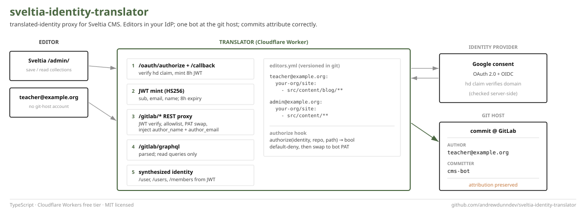
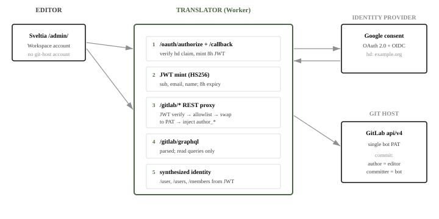

# sveltia-identity-translator

[](LICENSE)


A proxy that lets people edit a git-backed website through [Sveltia
CMS][sveltia] without having a GitLab account. Editors sign in with the
Google Workspace account they already have; one service-account token
does the GitLab API calls; each commit carries the editor as its
[author][git-author-committer] and the service account as committer. I
built it for my kids' school, where the teachers who write the website
had no reason to learn git, and it runs there as a [Cloudflare
Worker][cf-workers] on the free plan.

If your editors already have GitLab accounts, you don't need this: use
[`sveltia-cms-auth`][sveltia-auth]. This proxy is for the case where
the person editing and the git-host identity are not the same.

[sveltia]: https://sveltiacms.app/
[git-author-committer]: https://git-scm.com/book/en/v2/Git-Tools-Signing-Your-Work
[cf-workers]: https://developers.cloudflare.com/workers/
[sveltia-auth]: https://github.com/sveltia/sveltia-cms-auth

## Quick start

You need a Google Workspace tenant, a gitlab.com group holding the
repo Sveltia edits, a Cloudflare account, and a site already running
Sveltia. Each step has a longer walkthrough in `docs/`.

1. **GitLab.** Create a service account with Maintainer access to the
   group and an access token with scope `api`
   ([docs/gitlab-pat-setup.md](./docs/gitlab-pat-setup.md)).
2. **Google.** Create an OAuth client of type "Web application" with
   `https://<worker-hostname>/oauth/callback` as a redirect URI
   ([docs/google-oauth-setup.md](./docs/google-oauth-setup.md)).
3. **Cloudflare.** Configure and deploy the Worker
   ([docs/cloudflare-deploy.md](./docs/cloudflare-deploy.md)):

   ```bash
   git clone https://github.com/andrewdunndev/sveltia-identity-translator.git
   cd sveltia-identity-translator
   npm install
   cp wrangler.toml.example wrangler.toml   # set ALLOWED_DOMAIN and ALLOWED_SITES
   cp editors.yml.example editors.yml       # declare repos and editors
   npm run lint:editors
   npx wrangler deploy
   npx wrangler secret put OAUTH_CLIENT_ID
   npx wrangler secret put OAUTH_CLIENT_SECRET
   npx wrangler secret put GITLAB_API_TOKEN
   npx wrangler secret put JWT_SECRET        # openssl rand -hex 32
   curl https://<worker-hostname>/healthz    # prints "translator ok"
   ```

4. **Sveltia.** Point `admin/config.yml` at the Worker
   ([docs/sveltia-config.md](./docs/sveltia-config.md)):

   ```yaml
   backend:
     name: gitlab
     repo: your-org/your-site
     branch: main
     api_root: https://<worker-hostname>/gitlab
     auth_endpoint: oauth/authorize
     base_url: https://<worker-hostname>
     proxied: true
   ```

Open `/admin/` on your site, sign in through Google, save a test edit
and check `git log`: the author is the editor's email, the committer
is the service account.

### Configuration

Two plain variables in `wrangler.toml`:

| Var | Meaning |
|---|---|
| `ALLOWED_DOMAIN` | The Workspace primary domain. Sign-in is refused unless the id_token's `hd` claim equals it. |
| `ALLOWED_SITES` | Comma-separated hostnames that serve Sveltia. Each is accepted as the OAuth `site_id` and echoed as the CORS origin; an empty list refuses every site. |

Four secrets, set with `wrangler secret put`: `OAUTH_CLIENT_ID`,
`OAUTH_CLIENT_SECRET`, `GITLAB_API_TOKEN`, `JWT_SECRET`.

### As a dependency

The Worker is also a library, so a deployment can live in its own repo
with nothing but an `editors.yml` and a `wrangler.toml`:

```bash
npm install github:andrewdunndev/sveltia-identity-translator#v0.2.0
```

```ts
import editors from "../editors.yml";
import { createWorker } from "sveltia-identity-translator";

export default createWorker({ editors, name: "translator" });
```

`name` labels the `/healthz` body and the deny log lines. The consumer
copies the `[[rules]]` block from `wrangler.toml.example` so `.yml`
imports as text, and the `*.yml` module declaration from
`src/editors.d.ts`. `buildAuthorizer`, `buildBranchResolver`,
`buildIsEditor` and the `Env` type are exported alongside.

## How it works



1. **Sign-in.** `/oauth/authorize` sends the editor to Google with a
   signed `state` and a PKCE challenge; the verifier sits in a
   short-lived `__Host-` cookie. `/oauth/callback` accepts only a state
   it signed, for a site in `ALLOWED_SITES`, from the browser holding
   the verifier. It exchanges the code, reads the `id_token`, and
   checks issuer, audience, expiry, `hd` and `email_verified`.
2. **Session.** An editor listed in `editors.yml` gets an 8-hour HS256
   JWT bound to the Worker's origin, delivered by `postMessage` to the
   origin recorded in the state. Anyone else gets an error page.
3. **REST proxy.** `/gitlab/*` verifies the JWT and matches the request
   against a fixed route table of the calls Sveltia makes; anything
   else is a 403 with no upstream call. A commit is rebuilt from the
   fields Sveltia sends, pinned to the repo's `branch`, checked path by
   path against `write_roots` and the editor's globs, given
   `author_name` and `author_email`, and forwarded under the service
   token.
4. **GraphQL.** Sveltia reads through GraphQL and writes through REST.
   `/gitlab/graphql` parses the document and forwards it only when it
   is one of the project read queries Sveltia sends, for a repo the
   editor has an entry for. The sign-in permission probe
   (`userPermissions { pushCode }`) is answered `true` locally for
   those repos. Mutations and every other shape are a 403.
5. **Synthesized identity.** `GET /user`, `GET /projects/:id/users`
   and `GET /projects/:id/members/all/0` are answered from the JWT, so
   Sveltia sees the editor, with id 0, as a Maintainer of each repo the
   allowlist grants.

## editors.yml

```yaml
repos:
  your-org/your-site:
    branch: main                  # the only branch commits may target
    write_roots:                  # subtrees editors may ever write, by file type
      "src/content/blog/**": [md, yml, yaml, json]
      "public/images/uploads/**": [jpg, jpeg, png, webp, gif, avif, pdf]

admin@example.org:
  your-org/your-site:
    - "src/content/blog/**"
    - "public/images/uploads/**"

editor@example.org:
  your-org/your-site:
    - "src/content/blog/**"
```

An email with no entry cannot sign in. An entry under a repo grants
reads on it. A write must be a canonical path inside one of the repo's
`write_roots`, carry one of that root's extensions, and match one of
the editor's own globs (`*`, `**`, `?`). The roots bind every editor,
so a repo with no `write_roots` or no `branch` accepts no writes. List
as roots only the folders your Sveltia config declares, never anything
the build runs as code. `npm run lint:editors` checks the file and CI
runs it on every push, because a file that fails to parse deploys as
an empty allowlist.

Removing an editor's entry and redeploying denies their next request,
reads included, even on an unexpired session. Rotating `JWT_SECRET`
ends every session at once.

The allowlist is one implementation of the `Authorizer` interface in
`src/authorize.ts`, `(ctx) => boolean` over identity, repo, method and
path. Another source (a database, a directory query) is a new
implementation passed to the proxy in place of `buildAuthorizer`.

## Security model

The service token never leaves the Worker, and the Worker only spends
it on the route table above. Everything else follows from four
boundaries:

- **Domain.** The `hd` claim on the `id_token` must equal
  `ALLOWED_DOMAIN`. The `hd` parameter on the authorize URL only
  filters Google's account chooser. An empty `ALLOWED_DOMAIN` refuses
  every sign-in.
- **Editor.** A session is minted only for an email in `editors.yml`
  with at least one repo.
- **Site.** The token is posted only to an origin in `ALLOWED_SITES`,
  recorded in a state the Worker signed and bound to the browser that
  started the flow. CORS echoes only those origins.
- **Path.** Writes land only inside declared roots, with declared
  extensions, on the declared branch. Paths with `..`, empty segments,
  backslashes or control characters are refused before any check runs.

Not covered: Sveltia's own UI shows every collection to every editor,
so someone can open a collection they cannot save (the save is a 403).
There is no rate limiting and no refresh token; a session that expires
mid-edit means signing in again.

## Status and scope

- gitlab.com only; the upstream API URLs are fixed in the source.
- Google Workspace is the only identity provider exercised. The
  `IdPConfig` shape in `src/idp.ts` fits other OIDC providers with a
  hosted-domain claim, but none has been tried.
- Sveltia 0.179 or later. The proxy answers the access probes of
  0.179 (`users?search`) and 0.224 (`userPermissions { pushCode }`),
  and is tested against the queries of 0.233.1. Not served: the
  `root_dir` directory lookups, open authoring and the editorial
  workflow.
- In production at one school.

## Upgrading from 0.1.0

`editors.yml` gains a `repos:` section; a repo without `branch` and
`write_roots` there accepts no writes. `ALLOWED_SITES` is a new
required var. Session claims and lifetime changed, so editors sign in
again after the deploy. `CHANGELOG.md` lists what moved.

## Local dev and smoke test

```bash
cat > .dev.vars <<EOF     # gitignored
OAUTH_CLIENT_ID=<your client id>
OAUTH_CLIENT_SECRET=<your client secret>
GITLAB_API_TOKEN=<your token>
JWT_SECRET=<openssl rand -hex 32>
EOF
npm run dev               # http://localhost:8787
npm test                  # offline suite
```

The smoke harness mints JWTs with `JWT_SECRET` and exercises the
contract Sveltia depends on against a running Worker: the OAuth
redirect, JWT checks, the route table, the synthesized endpoints,
GraphQL read and refusal, CORS, a commit as the admin with the author
injected, writes refused outside the editor's globs and outside the
roots, and the token's expiry.

```bash
JWT_SECRET=<the secret> node scripts/smoke.mjs \
  --base-url https://<worker-hostname> \
  --repo your-org/your-site --site example.com \
  --admin admin@example.org --editor editor@example.org
```

`blocked` cases are environment problems the proxy cannot fix (branch
protection refusing the service account, a token without an expiry).
The Google round-trip itself is checked once in a browser.

## Further reading

[ARCHITECTURE.md](./ARCHITECTURE.md) has the reasoning behind the
decisions that aren't obvious from "it's a proxy": why GraphQL is
parsed instead of forwarded, why `hd` is checked twice, why one Worker
serves many sites, why sessions are 8 hours with no refresh, and why
the smoke harness mints its own tokens. [CONTRIBUTING.md](./CONTRIBUTING.md)
has the contribution shape.

Prior art: [`sveltia-cms-auth`][sveltia-auth] is Sveltia's own OAuth
proxy, where the editor's GitLab token is what reaches the CMS;
[`vencax/netlify-cms-github-oauth-provider`][vencax] is the same shape
for Decap. Both assume the editor has a git-host account. A Decap
version of this proxy would differ only in the `postMessage` shape; I
haven't built one.

[vencax]: https://github.com/vencax/netlify-cms-github-oauth-provider

## License

[MIT](./LICENSE).

---

Built by [Andrew Dunn](https://andrew.dunn.dev), with collaboration from [Andrew DeJong](https://dejong.engineering/) ([@adejong5](https://github.com/adejong5)), for the school he volunteers at. The companion writeup is at [andrew.dunn.dev/writing/enabling-editors-to-use-git-without-knowing](https://andrew.dunn.dev/writing/enabling-editors-to-use-git-without-knowing/).
